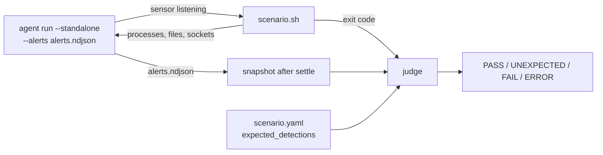

# Architecture

The repository has no build and no runtime of its own. It is a catalog of stimuli plus the
contract that lets other tools judge them. This page describes that contract and the path a run
takes from script to verdict.

## Layout

| Path | Contents |
| --- | --- |
| [`scenarios/*.sh`](../scenarios/) | Linux scenarios, one technique each, run with Bash |
| [`scenarios/*.yaml`](../scenarios/) | One sidecar per Linux scenario: the detections it must trigger ([sidecar-format.md](sidecar-format.md)) |
| [`scenarios/sidecars.sha256`](../scenarios/sidecars.sha256) | SHA-256 of every sidecar, checked by [`tools/check-sidecar-bytes.py`](../tools/check-sidecar-bytes.py) |
| [`scenarios/*.ps1`](../scenarios/) | Windows scenarios for Windows PowerShell 5.1; no sidecars yet |
| [`scenarios/common.ps1`](../scenarios/common.ps1) | Helpers dot-sourced by every Windows scenario, including the self-checking agent harness |
| [`scenarios/response-marker.yar`](../scenarios/response-marker.yar) | YARA rule that `response.sh` needs in the agent's content directory |
| [`scenarios/pending-syscall-exit-exec.c`](../scenarios/pending-syscall-exit-exec.c), [`scenarios/v652-beacon.rs`](../scenarios/v652-beacon.rs) | Compiled stimuli, built by hand on a test machine |
| [`lib/common.sh`](../lib/common.sh) | Helpers sourced by the shell scenarios: cleanup registry, loopback listeners, preconditions, self-check verdict |
| [`ml-capture/`](../ml-capture/) | Workloads that record event data for the ML models ([ml-capture.md](ml-capture.md)) |
| [`tools/`](../tools/) | Repository checks ([testing.md](testing.md)) |

`lib/common.sh` lives outside `scenarios/` on purpose: the rig treats every `scenarios/*.sh` as a
scenario and requires a sidecar and a catalog row for it, and a sourced helper is neither.

## The contract

A scenario is consumed through three channels. Everything else about it (its output text, its
timing, its temporary files) is free to change.

1. **Behavior.** The process tree, names, arguments, paths, syscalls and timing the script
   produces are the stimulus. The agent sees them and nothing else, so they are part of the
   contract: wrapping a command in an extra subshell, moving inline Python into a `.py` file or
   renaming a fixed path can change what fires. [writing-scenarios.md](writing-scenarios.md#the-stimulus-is-the-behavior)
   lists the rules that follow.
2. **Exit code.** `0` ran (and its self-check passed where it has one), `1` ran and a self-check
   failed, `2` a precondition was not met and nothing was attempted. See
   [running.md](running.md#exit-codes).
3. **Sidecar.** For a Linux scenario, `<name>.yaml` lists each expected alert technique with a
   count window. Consumers read it without executing anything.

What a scenario does **not** do is read the agent's alert log to decide its own result (two
exceptions, `signal.sh` and the Windows `-AgentExe` runs, are described below). Judging alerts
against expectations is the consumer's job, so one judge applies the same rules to every
scenario, and the scenario itself stays a pure stimulus.

## One run, end to end

1. The agent starts standalone with an alert log (`--alerts`) and usually an event log
   (`--events`). Some scenarios need an extra flag (`--enable-dns-capture`, `--enable-kill`), a
   configuration entry (`[[logs.sources]]`, `[deception] canary_dirs`) or extra content (a YARA
   rule); the [catalog](linux-scenarios.md) says which.
2. Once the sensor is up, the scenario runs to completion and exits.
3. The consumer waits for alerts to settle, then snapshots the alert log. The rig snapshots
   **before** stopping the agent, because the stop signal is itself a tamper attempt
   (`T1562.001`) that would land in the log.
4. Each line of `alerts.ndjson` is an
   [`AlertRecord`](https://github.com/synthaea-lab/agent/blob/main/crates/sinks/src/lib.rs):
   `{"timestamp_ns": ..., "technique": "...", "message": "..."}`. The judge counts lines per
   exact `technique` string and compares each count with the sidecar's
   `[min_count, min_count + tolerance]` window.

Rule alerts and correlation alerts share that file and that field, which is why a sidecar can
expect a single ATT&CK ID (`T1059`), a combined correlation label (`T1105/T1059/T1071`) or a
non-ATT&CK label such as `BAYES` or `RESPONSE-KILL` with the same syntax.

## Consumers

| Consumer | Reads | Judges | Where |
| --- | --- | --- | --- |
| Rig, Linux guests | The sidecar's `expected_detections` (a line parser) and the exit code | `PASS`, `UNEXPECTED`, `FAIL`, `ERROR`, `SKIP` | [`runner/run-scenarios.sh`](https://github.com/synthaea-lab/rig/blob/main/runner/run-scenarios.sh) |
| Rig, Windows guests | The sidecar if one exists, else the `expect` column of its own catalog | Same results | [`runner/run-scenarios.ps1`](https://github.com/synthaea-lab/rig/blob/main/runner/run-scenarios.ps1) |
| ML scenario replay | The whole sidecar (`yaml.safe_load`) and an `alerts.ndjson` | `passed` true or false, recorded with the sidecar's SHA-256 | [`synthaea_ml/evaluation/scenario_replay.py`](https://github.com/synthaea-lab/ml/blob/main/synthaea_ml/evaluation/scenario_replay.py) |
| A person | The script's header comment, the sidecar | By eye | [running.md](running.md#by-hand) |

How to run each scenario on a given guest (root or not, which commands it needs, extra agent
flags, environment, settle delay) is the rig's knowledge, kept in its
[`runner/scenarios.conf`](https://github.com/synthaea-lab/rig/blob/main/runner/scenarios.conf).
What a scenario must trigger is this repository's knowledge, kept in the sidecar. The split keeps
sidecars free of lab details, which matters because sidecar bytes are frozen by the ML pipeline
([sidecar-format.md](sidecar-format.md#hash-binding)).

## Self-checking scenarios

A few scenarios also verify their own side of the outcome, because the alert alone does not show
it:

| Scenario | Checks | Reports |
| --- | --- | --- |
| [`response.sh`](../scenarios/response.sh), [`ransomware-reflex.sh`](../scenarios/ransomware-reflex.sh) | Was the process killed (exit 137) and the payload quarantined, as `EXPECT=enforce` or `EXPECT=observe` says | `FAIL:` lines, exit 1 |
| [`bind-shell.sh`](../scenarios/bind-shell.sh) | A shell actually answered on the port | `FAIL:` line, exit 1 |
| [`signal.sh`](../scenarios/signal.sh) | Counts signal events and `T1562.001` alerts in the agent's files, before and after each step | `PASS` / `FAIL` lines, exit 1 |
| [`bits-job.ps1`](../scenarios/bits-job.ps1), [`windows-container.ps1`](../scenarios/windows-container.ps1) with `-AgentExe` | Start their own agent and read its events and alerts | `PASS` / `FAIL` lines, exit 1 |

`signal.sh` reads the agent's files itself because what it measures (zero events from unrelated
signal traffic, one event and no alert from a `kill -0`) cannot be expressed as an alert count.
The Windows `-AgentExe` runs predate the Windows rig runner and remain the way to run those two
scenarios.

The rig quotes up to five lines matching `FAIL` or `ERROR` from a failing scenario's output in
its report, which is why the shell helpers print those tokens
([`check_fail`](../lib/common.sh), [`die_precondition`](../lib/common.sh)).
